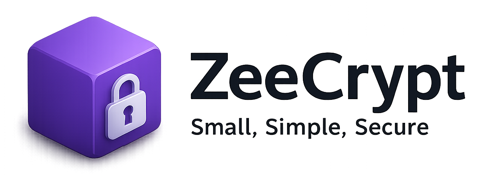
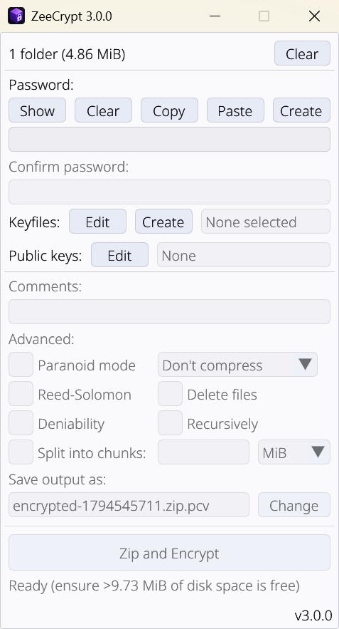

ZeeCrypt is a very small, very simple, yet very secure encryption tool that you can use to protect your files. It's a Windows-only fork of [Picocrypt](https://github.com/Picocrypt/Picocrypt), designed to be the <i>go-to</i> tool for file encryption, with a focus on security, simplicity, and reliability. ZeeCrypt uses the secure XChaCha20 cipher and the Argon2id key derivation function to provide a high level of security.

🚀 **This repo is actively maintained.** Unlike the original (now-archived) Picocrypt, ZeeCrypt is under active development — bug reports, feature requests, and suggestions are welcome, so feel free to open an issue. See [CONTRIBUTING.md](CONTRIBUTING.md) if you'd like to contribute code, and [SECURITY.md](SECURITY.md) to report a vulnerability.

## What's new in v3.0.0
- **Public keys:** encrypt to people's public keys instead of sharing a password, with post-quantum protection (X25519 + ML-KEM-768).
- **Signatures:** sign volumes so recipients know they came from you.
- **Security keys:** require a YubiKey or other FIDO2 key as well as the password.
- **Stronger format:** every chunk of data is verified before it's decrypted, and comments can't be changed without detection.
- **zstd compression**, **Explorer "Encrypt with" / "Decrypt with" entries**, and **signed updates**.

Volumes made with v3.0.0 can't be opened by earlier versions; see [Compatibility and upgrading](#compatibility-and-upgrading) and the [Changelog](Changelog.md).

 

# Downloads

ℹ️ **You are highly recommended to read through the [Features](#features) section below to fully understand the features and limitations of ZeeCrypt before using it.** ℹ️

Make sure to only download ZeeCrypt from this repository. When sharing ZeeCrypt with others, be sure to link to this repository to prevent any confusion.

## Windows
To download the latest, standalone, and portable executable for Windows, click <a href="https://github.com/TheZeekA/ZeeCrypt/releases/latest/download/ZeeCrypt.exe">here</a>.

If you use ZeeCrypt frequently, you can also download the [installer](https://github.com/TheZeekA/ZeeCrypt/releases/latest/download/ZeeCrypt-Installer.msi) for Start Menu and Desktop shortcuts, automatic file extension association, and right-click "Open with ZeeCrypt", "Encrypt with ZeeCrypt" and "Decrypt with ZeeCrypt" entries in Explorer (on Windows 11, under "Show more options"). This installs to Program Files, so it requires administrator privileges (a UAC prompt) during installation.

If your antivirus flags ZeeCrypt as a virus, please report it as a false positive to help everyone.

ZeeCrypt targets Windows 11 only; it is not built or tested for macOS or Linux.

## Compatibility and upgrading
- **v3.0.0 introduces a new volume format (v3).** v3.0.0 opens all your existing volumes, but volumes it creates can't be opened by v2.x or earlier. If you share volumes with someone, make sure they upgrade too.
- **Upgrading to v2.0.0 from v1.50 or v1.51:** volumes that use keyfiles can't be opened by v2.0.0 (a security fix changed how their header is authenticated). Decrypt them with your current version *before* upgrading, then re-encrypt with v2.0.0. Password-only volumes open normally.
- **Coming from Picocrypt:** ZeeCrypt can't open volumes made by Picocrypt or by ZeeCrypt versions before 1.50. Decrypt them with the tool that created them, then re-encrypt with ZeeCrypt.
- See the [Changelog](Changelog.md) for everything that changed in each release.

# Comparison
Here's how ZeeCrypt compares to other popular encryption tools.

|                | ZeeCrypt       | VeraCrypt      | 7-Zip GUI      | BitLocker      | Cryptomator    |
| -------------- | -------------- | -------------- | -------------- | -------------- | -------------- |
| Free           |✅ Yes         |✅ Yes          |✅ Yes         |✅ Bundled      |✅ Yes         |
| Open Source    |✅ GPLv3       |✅ Multi        |✅ LGPL        |❌ No           |✅ GPLv3       |
| Cross-Platform |❌ Windows only |✅ Yes         |❌ No          |❌ No           |✅ Yes         |
| Size           |✅ 4.5 MiB     |❌ 20 MiB       |✅ 2 MiB       |✅ N/A          |❌ 50 MiB      |
| Portable       |✅ Yes         |✅ Yes          |❌ No          |✅ Yes          |❌ No          |
| Permissions    |✅ None        |❌ Admin        |❌ Admin       |❌ Admin        |❌ Admin       |
| Ease-Of-Use    |✅ Easy        |❌ Hard         |✅ Easy        |✅ Easy         |🟧 Medium      |
| Cipher         |✅ XChaCha20   |✅ AES-256      |✅ AES-256     |🟧 AES-128      |✅ AES-256     |
| Key Derivation |✅ Argon2      |🟧 PBKDF2       |❌ SHA-256     |❓ Unknown      |✅ Scrypt      |
| Data Integrity |✅ Always      |❌ No           |❌ No          |❓ Unknown      |✅ Always      |
| Deniability    |✅ Supported   |✅ Supported    |❌ No          |❌ No           |❌ No          |
| Reed-Solomon   |✅ Yes         |❌ No           |❌ No          |❌ No           |❌ No          |
| Compression    |✅ Yes         |❌ No           |✅ Yes         |✅ Yes          |❌ No          |
| Public Keys    |✅ Post-quantum |❌ No          |❌ No          |❌ No           |❌ No          |
| Hardware Keys  |✅ FIDO2       |🟧 Tokens       |❌ No          |✅ TPM          |❌ No          |
| Signatures     |✅ Yes         |❌ No           |❌ No          |❌ No           |❌ No          |
| Telemetry      |✅ None        |✅ None         |✅ None        |❓ Unknown      |✅ None        |

Keep in mind that while ZeeCrypt does most things better than other tools, it's not a one-size-fits-all and doesn't try to be. There are use cases such as full-disk encryption where VeraCrypt and BitLocker would be a better (and the only) choice. So while ZeeCrypt is a great choice for the majority of people doing file encryption on Windows, you should still do your own research and use what's best for you.

# Features
ZeeCrypt is a very simple tool and most users will intuitively understand how to use it in a few seconds. On a basic level, simply dropping your files, entering a password, and hitting Encrypt is all that's needed to encrypt your files. Dropping the output back into ZeeCrypt, entering the password, and hitting Decrypt is all that's needed to decrypt those files. Pretty simple, right?

While being simple, ZeeCrypt also strives to be powerful in the hands of knowledgeable and advanced users. Thus, there are some additional options that you may use to suit your needs. Read through their descriptions carefully as some of them can be complex to use correctly.
<ul>
	<li><strong>Password generator</strong>: ZeeCrypt provides a secure password generator that you can use to create cryptographically secure passwords. You can customize the password length, as well as the types of characters to include.</li>
	<li><strong>Comments</strong>: Use this to store <strong>non-sensitive</strong> text along with the volume (<strong>it won't be encrypted</strong> and simply can't be by design). For example, you can put a description of the file you're encrypting before sending it to someone. When the person you sent it to drops the volume into ZeeCrypt, your description will be shown to that person. Or, if you're backing up personal files, you can give a description of the volume's contents so you can quickly remind yourself without having to fully decrypt. Comments aren't encrypted, so anyone can read them. In volumes made with v3.0.0 or later they're authenticated: if someone changes them, decryption fails (though the changed text is shown until you try). In older volumes they could be changed without detection. <strong>Thus, it should only be used for non-sensitive, informational purposes in trusted environments.</strong></li>
	<li><strong>Keyfiles</strong>: ZeeCrypt supports the use of keyfiles as an additional form of authentication (or the only form of authentication). Any file can be used as a keyfile, and a secure keyfile generator is provided for convenience. Not only can you use multiple keyfiles, but you can also require the correct order of keyfiles to be present for a successful decryption to occur. A particularly good use case of multiple keyfiles is creating a shared volume, where each person holds a keyfile, and all of them (and their keyfiles) must be present to decrypt the shared volume. By checking the "Require correct order" box and dropping your keyfile in last, you can also ensure that you'll always be the one clicking the Decrypt button. <strong>Use the keyfile generator whenever possible for the best security.</strong></li>
	<li><strong>Paranoid mode</strong>: Using this mode will encrypt your data with both XChaCha20 and Serpent in a cascade fashion, and use HMAC-SHA3 to authenticate data instead of BLAKE2b. Argon2 parameters will be increased significantly as well. This is recommended for protecting top-secret files and provides the highest level of practical security attainable. For a hacker to break into your encrypted data, both the XChaCha20 cipher and the Serpent cipher must be broken, assuming you've chosen a good password. It's safe to say that in this mode, your files are impossible to crack. Keep in mind, however, that this mode is slower and isn't really necessary unless you're a government agent with classified data or a whistleblower under threat.</li>
	<li><strong>Reed-Solomon</strong>: This feature is very useful if you are planning to archive important data on a cloud provider or external medium for a long time. If checked, ZeeCrypt will use the Reed-Solomon error correction code to add 8 extra bytes for every 128 bytes of data to prevent file corruption. This means that up to ~3% of your file can corrupt and ZeeCrypt will still be able to correct the errors and decrypt your files with no corruption. Of course, if your file corrupts very badly (e.g., you dropped your hard drive), ZeeCrypt won't be able to fully recover your files, but it will try its best to recover what it can. Note that this option will slow down encryption and decryption speeds significantly.</li>
	<li><strong>Force decrypt</strong>: ZeeCrypt automatically checks for file integrity upon decryption. If the file has been modified or is corrupted, ZeeCrypt will automatically delete the output for the user's safety. If you would like to override these safeguards, check this option. Also, if this option is checked and the Reed-Solomon feature was used on the encrypted volume, ZeeCrypt will attempt to recover as much of the file as possible during decryption.</li>
	<li><strong>Split into chunks</strong>: Don't feel like dealing with gargantuan files? No worries! With ZeeCrypt, you can choose to split your output file into custom-sized chunks, so large files can become more manageable and easier to upload to cloud providers. Simply choose a unit (KiB, MiB, GiB, or TiB) and enter your desired chunk size for that unit. To decrypt the chunks, simply drag one of them into ZeeCrypt and the chunks will be automatically recombined during decryption.</li>
	<li><strong>Compression</strong>: By default, ZeeCrypt merges multiple files into a zip file with no compression, which is fastest and opens anywhere. To compress, choose Fast, Balanced or Maximum (this works for a single file too): the files go into a <code>.tar.zst</code> archive (zstd compression, several times faster than zip's Deflate at a better ratio), which Windows 11 Explorer and 7-Zip can open. Auto unzip extracts both kinds after decryption. Compressing before encrypting can reveal a little about the contents through the output size; that only matters if an attacker can influence the data and watch many re-encryptions of it, which isn't how ZeeCrypt is normally used.</li>
	<li><strong>Public keys</strong>: Instead of sharing a password, encrypt to people's public keys. Click "Edit" next to "Public keys" to create your identity (a file protected by your password: back it up!), copy your public key to share it, and add contacts by copying their public key. When encrypting, tick who should be able to open the volume; a volume can have a password too. When decrypting, an open identity is tried automatically. Public keys use X25519 combined with ML-KEM-768, so they're also designed to resist quantum computers. They can't be combined with deniability.</li>
	<li><strong>Signing</strong>: With your identity open, tick "Sign as you" to prove to recipients that the volume came from you and wasn't changed. When decrypting a signed volume, ZeeCrypt shows "signed by" and the contact's name, or the fingerprint of an unknown signer; compare a fingerprint with the sender over another channel before trusting it. Only people who can open the volume can see who signed it.</li>
	<li><strong>Security keys</strong>: Tick "Also require a security key" in the Public keys dialog to need a FIDO2 key (YubiKey, SoloKey, Titan, ...) as well as the password; you'll touch it when encrypting and decrypting. Needs Windows 11 22H2 or later and a key with a PIN. If you lose the key, the password alone can't open the volume, so also encrypt to your own public key as a backup.</li>
	<li><strong>Deniability</strong>: ZeeCrypt volumes typically follow an easily recognizable header format. However, if you want to hide the fact that you are encrypting your files, enabling this option will provide you with plausible deniability. The output volume will be indistinguishable from a stream of random bytes, and no one can prove it is a volume without the correct password. This can be useful in an authoritarian country where the only way to transport your files safely is if they don't "exist" in the first place. Keep in mind that this mode slows down encryption and decryption speeds, requires you to manually rename the volume afterward, renders comments useless, requires a password (keyfiles alone aren't enough), and also voids the extra security precautions of the paranoid mode, so you should only use it if absolutely necessary. <strong>If you've never heard of plausible deniability, this feature is not for you.</strong></li>
	<li><strong>Recursively</strong>: If you want to encrypt and/or decrypt a large set of files individually, this option will tell ZeeCrypt to go through every recursive file that you drop in and encrypt/decrypt it separately. This is useful, for example, if you are encrypting thousands of large documents and want to be able to decrypt any one of them in particular without having to download and decrypt the entire set of documents. Files whose output already exists are skipped rather than overwritten, and a summary at the end shows how many were skipped or failed. <strong>Keep in mind that this is a very complex feature that should only be used if you know what you are doing.</strong></li>
	<li><strong>Explorer integration</strong>: If you installed ZeeCrypt with the MSI installer, right-clicking shows "Open with ZeeCrypt" (detects whether to encrypt or decrypt), "Encrypt with ZeeCrypt" on files and folders, and "Decrypt with ZeeCrypt" on volumes. On Windows 11 they are under "Show more options". ZeeCrypt runs as a single window: selecting several items opens them together, and anything opened while ZeeCrypt is already running goes to the existing window (unless it is busy). From the command line, <code>ZeeCrypt.exe --encrypt -- &lt;paths&gt;</code> and <code>--decrypt</code> do the same.</li>
	<li><strong>Update checker</strong>: Click the version number at the bottom-right of the window to check for a new release. Nothing happens automatically - checking only happens when you click, and if an update is found, you'll see the release notes with an "Update Now" button rather than anything downloading or installing on its own. The downloaded update is verified against its published checksum and, from releases that carry one, an Ed25519 signature made with the project's release key (built into the app), before it replaces the running executable. A signature also covers the version number, so an old release can't be passed off as a new one. Copies installed with the MSI (in Program Files) aren't replaced in place; update them by running the new installer.</li>
</ul>

# Security
For more information on how ZeeCrypt handles cryptography, see <a href="Internals.md">Internals</a> for the technical details. ZeeCrypt is a fork of [Picocrypt](https://github.com/Picocrypt/Picocrypt), which was [independently audited](https://www.radicallyopensecurity.com/) before this fork's changes were made; ZeeCrypt itself has not yet been separately audited, so treat its Windows-only changes accordingly.

<strong>ZeeCrypt operates under the assumption that the host machine it is running on is safe and trusted. If that is not the case, no piece of software will be secure, and you will have much bigger problems to worry about. As such, ZeeCrypt is designed for the offline security of volumes and does not attempt to protect against side-channel analysis.</strong>

PCC-004 (decrypt-then-verify), the last open finding from the original Picocrypt audit, is fixed in the v3 volume format (v3.0.0): each chunk of data is authenticated before it's decrypted. Volumes made with earlier versions still use the old check, which happens after decryption but before the output is saved; see [Internals](Internals.md#decrypt-then-verify-v2-volumes-only).

ZeeCrypt makes no network requests on its own. The only exception is the update checker (bottom-right of the window), which only runs when you click it — it queries the GitHub Releases API and, if you choose to install an update, verifies its SHA-256 checksum (and the release signature, once releases are signed) before replacing the running executable. Nothing is ever downloaded or applied without you explicitly clicking to do so.

# FAQ
**Does the "Delete files" feature shred files?**

No, it doesn't shred any files and just deletes them as your file manager would. On modern storage mediums like SSDs, there is no such thing as shredding a file since wear leveling makes it impossible to overwrite a particular sector. Thus, to prevent giving users a false sense of security, ZeeCrypt doesn't include any shredding features at all.

**Is ZeeCrypt quantum-secure?**

Yes, for encryption. Password- and keyfile-protected volumes only use symmetric cryptography (XChaCha20, Serpent, Argon2, BLAKE2b, SHA-3), which is considered resistant to quantum computers. Public-key volumes combine X25519 with ML-KEM-768, a post-quantum algorithm standardized by NIST (FIPS 203), so they stay secure as long as either one holds. Sender signatures use Ed25519, which a large quantum computer could forge; that would let someone fake a "signed by", but not read or change your encrypted data.

# License
This project is licensed under **GPL-3.0-only**, as a fork of [Picocrypt](https://github.com/Picocrypt/Picocrypt) (also GPL-3.0-only).
